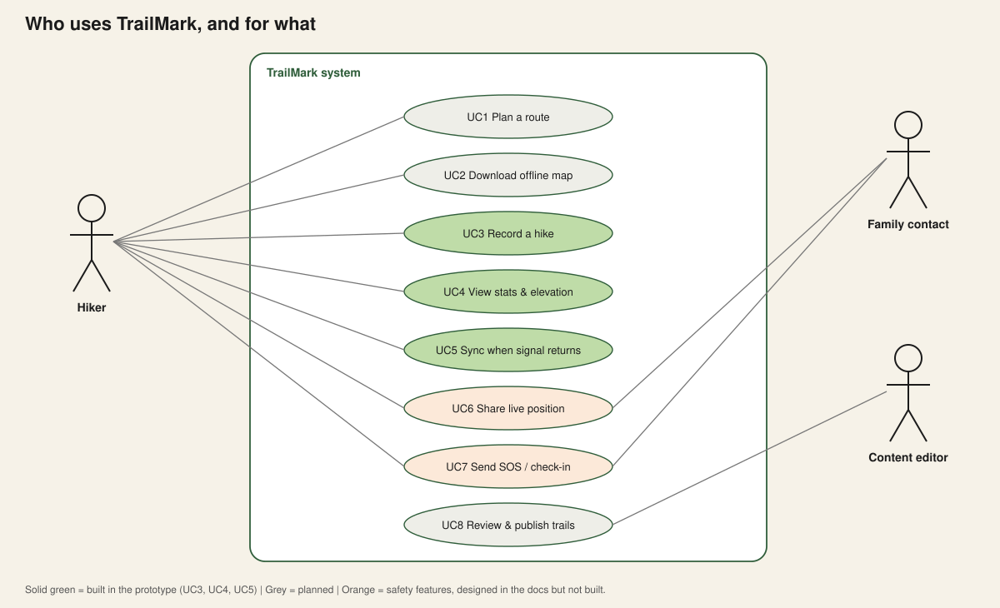

# 2. Use cases

## Who uses it (actors)
- **Hiker**: the main user. Goes out for hours or days.
- **Family contact**: someone at home who wants to know the hiker is safe.
- **Content editor**: a person who checks and publishes trail information.

## The use cases in plain words

### UC3. Record a hike *(built)*
- **Who:** Hiker
- **Before:** Phone has GPS. Signal is *not* needed.
- **Steps:** Press Start, walk, press Finish.
- **Result:** Hike is saved on the phone with distance, climb, and the full path.
- **What can go wrong, and what we do:**
  - *GPS jumps by 40 m for a moment* → the recorder drops that fix.
  - *Standing still for a snack* → tiny moves are ignored so distance does not grow.
  - *App is closed or phone dies* → points are saved in small batches, so at most the last few are lost.
  - *Location permission refused* → we show an error and do not record.

### UC4. View stats and elevation *(built)*
- **Who:** Hiker
- **Steps:** Open a hike from the list.
- **Result:** See the path, distance, climb, time, and a height chart.
- **Detail:** The path is *simplified* before drawing (doc 05), so long hikes still draw fast.

### UC5. Sync when signal returns *(built)*
- **Who:** Hiker (but it happens by itself)
- **Before:** At least one hike or edit is waiting in the outbox.
- **Steps:** Signal returns, app uploads, then downloads anything new.
- **Result:** Server and phone agree. The banner says "Synced".
- **Rules:** Uploading twice is harmless. If two phones edited the same hike, the **newest edit wins** (doc 04).

### UC1. Plan a route *(designed)*
Pick a trail, see its length, climb and difficulty, and save it for the trip. Needs trail data and search on the server (doc 06).

### UC2. Download offline map *(designed)*
Choose an area while on Wi-Fi. The app stores map tiles so the map works on the mountain. This is usually the **paid feature** and the **biggest cost** (doc 08).

### UC6. Share live position *(designed)*
The hiker's phone sends its latest position whenever there is any signal. The family contact sees "last seen 2 h ago near the summit". Even a *stale* position is very valuable for rescue.

### UC7. Send SOS / check-in *(designed)*
"If I do not check in by 18:00, tell my contact where I was last seen." Needs care, because a false alarm and a missed alarm are both bad (doc 07).

### UC8. Review and publish trails *(designed)*
If hikers can submit trails, someone must check them for errors and dangerous advice.

## A user story to test the design against
> *Mya starts at 6:00 in a valley with no signal. At 10:00 she reaches the summit and renames her hike "Sunrise ridge". At 14:00 she reaches a village with one bar of signal for 30 seconds. At 20:00 she is home on Wi-Fi.*

The design must make sure that:
- the rename and the track are never lost,
- the 30-second window is enough to upload what matters most (small data first),
- and her family can see "last seen at the village at 14:00".

That 30-second window is why the outbox **sends only the newest version** (built), and why a real product should also **upload a simplified track first and the full detail later** (designed; the prototype currently uploads every point).
