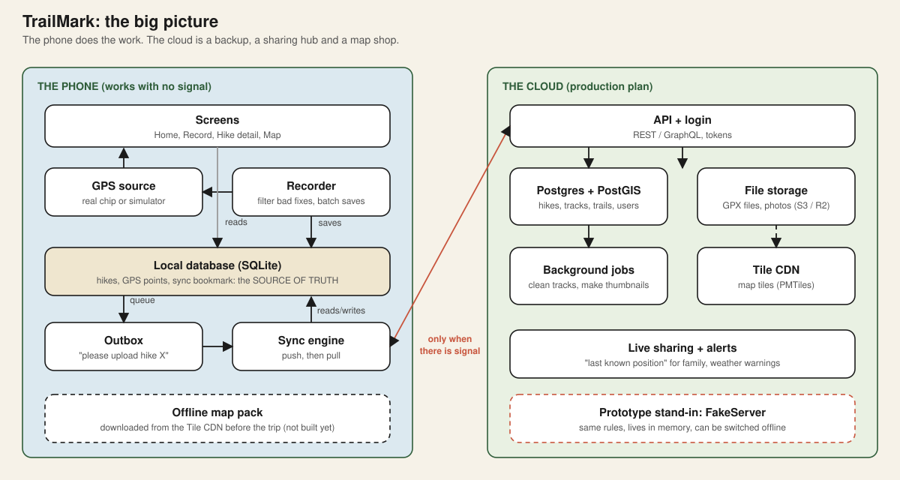
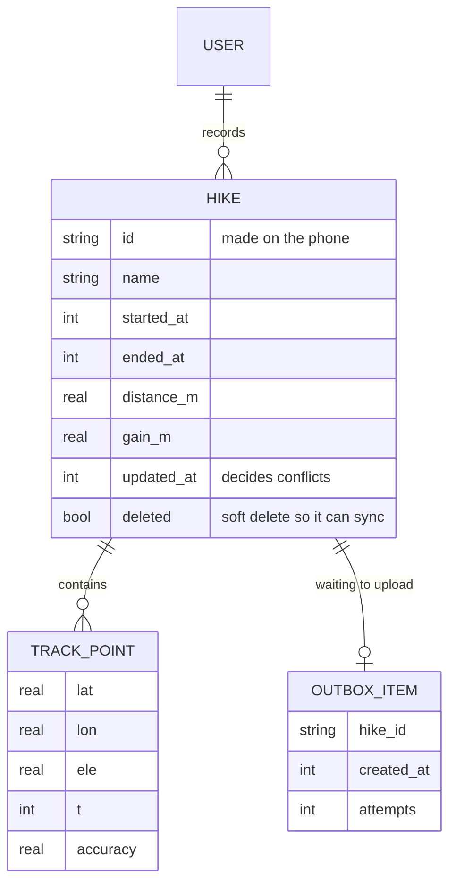
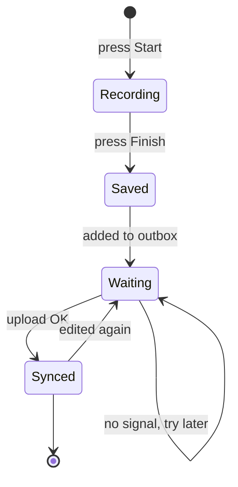

# 3. System architecture

## The one rule that shapes everything
> **The screen reads only from the phone's own database. It never waits for the network.**

This is called **offline-first**. The network is not a requirement. It is a *bonus* that happens when available.

## The parts

### On the phone
| Part | Job | Code |
|---|---|---|
| Screens | Show hikes, record, show detail | `lib/ui/` |
| GPS source | Produces location fixes (real chip or demo trail) | `lib/tracking/gps_source.dart` |
| Recorder | Drops bad fixes, saves good ones in batches | `lib/tracking/recorder.dart` |
| Local database | The source of truth on the phone | `lib/data/` |
| Outbox | A list of "please upload hike X" | `lib/data/local_store.dart` |
| Sync engine | Push the outbox, then pull changes | `lib/sync/sync_engine.dart` |
| App state | Glue between screens and the rest | `lib/app_state.dart` |

### In the cloud (the plan for a real product)
| Part | Job | Why this choice |
|---|---|---|
| API + login | The only door into the system | Keeps rules in one place |
| Postgres + PostGIS | Hikes, tracks, trails, users | PostGIS answers "what is near me?" fast (doc 06) |
| File storage | GPX files, photos | Cheap and big; not for a database |
| Background jobs | Clean tracks, make thumbnails | Keeps the API fast |
| Tile CDN | Serves map tiles | Tiles are the largest traffic (doc 08) |
| Live sharing | Stores "last known position" | The safety feature |

The prototype replaces the cloud with `FakeServer`, an in-memory class that follows the same rules (numbered changes, ignores old edits, can be unreachable). Swapping in a real server later only changes that one class.

## Data model

Three small decisions worth noticing:
- **IDs are made on the phone.** The phone cannot ask a server for a number when offline.
- **Deletes are soft** (`deleted = true`). A real delete would leave nothing to sync to other devices.
- **Track points are never edited.** They only get added. That makes them very easy to sync (doc 04).

## Life of a hike

## Technology choices (and the honest reasons)

| Choice | Why | Alternative |
|---|---|---|
| Flutter | One codebase, and it is what I already know | React Native, native |
| SQLite (`sqflite`) | Proven, small, works offline | Drift, Realm, Isar |
| `geolocator` | Standard GPS plugin | `flutter_background_geolocation` (paid, better for background) |
| Custom painter for the map | Zero dependencies, works anywhere | MapLibre (real tiles; the next step) |
| In-memory fake server | Lets anyone run the demo with no setup | A small real API |
