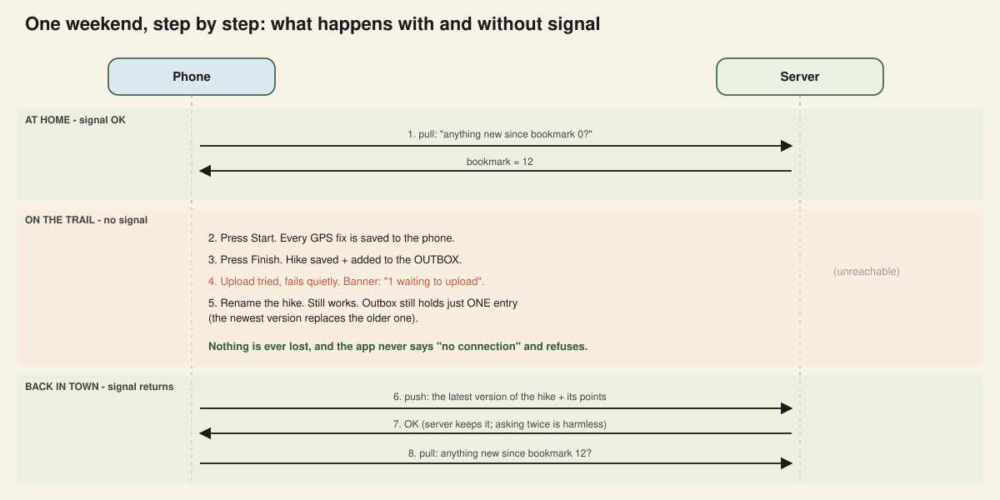
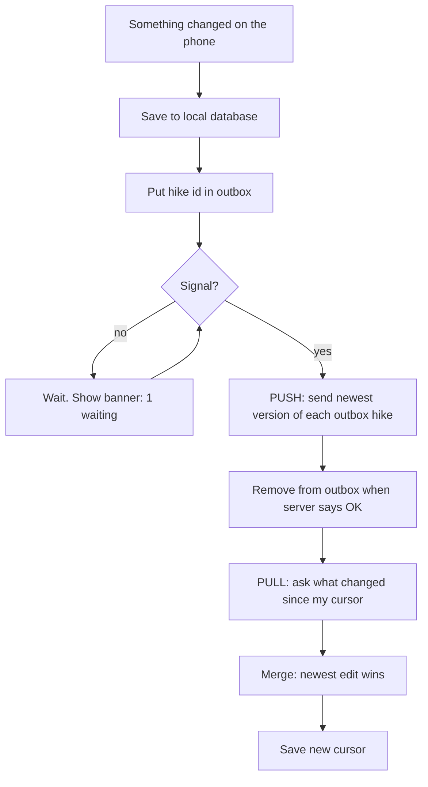
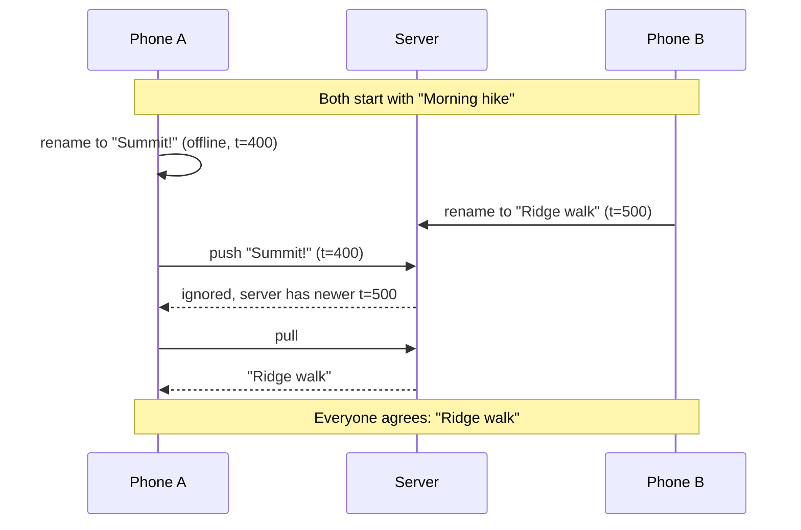

# 4. Offline-first and sync

This is the heart of the project. Code: [`lib/sync/sync_engine.dart`](../lib/sync/sync_engine.dart). Tests: [`test/sync_test.dart`](../test/sync_test.dart).

## The idea in kid-friendly words
Imagine writing a diary on the mountain and mailing the pages when you reach a town.
- The diary is the **local database**.
- The envelope pile is the **outbox**.
- The post office is the **server**.
- The bookmark of "last letter I received" is the **cursor**.

## Step by step

### 1. The outbox keeps *one* entry per hike
If you rename a hike three times offline, the outbox still says only "hike A needs uploading". At upload time we send the **latest** version. This saves bandwidth, which matters in a 30-second signal window.

### 2. Uploading twice must be harmless (idempotency)
The phone may upload, the signal drops, and the phone never hears "OK". It will try again. So the server must handle the same upload twice without creating a duplicate. Here, the hike id is the key, so the second upload simply overwrites with identical data.

> Test: *"retrying the same upload does not create duplicates"*

### 3. Pull only the difference (cursor)
The server numbers every change (1, 2, 3...). The phone remembers "I have everything up to 12". Next time it asks "give me everything after 12". No need to download all hikes again.

> Test: *"pull downloads only what changed since the bookmark"*

### 4. Conflicts: newest edit wins

This is **last-write-wins (LWW)**. It is simple and good enough for names and notes.

> Tests: *"the newer edit wins, even if it arrives second"* and *"my newer unsent edit survives a pull"*

### 5. Why GPS points never conflict
Points are only ever **added** while recording. Nobody edits point #57. Data that is only added, never changed, cannot conflict. This is a very useful design trick: **make as much data append-only as possible**.

### 6. Deleting
A delete is just an edit that sets `deleted = true`, so it syncs like anything else.

## Known weak spots (be honest with the client)

| Weak spot | Why it matters | Real fix |
|---|---|---|
| LWW trusts **phone clocks** | A phone with the wrong time can "win" unfairly | Let the server stamp the time, or use hybrid logical clocks |
| Whole-hike overwrite | If A edits the name and B edits the notes, one edit is lost | Merge per field, or use CRDTs |
| No retry back-off | We count attempts but retry at once | Exponential back-off with a cap |
| Big uploads | A 10-hour hike plus photos can be many MB | Resumable, chunked uploads (the tus protocol) |
| No login | Anyone could read anything | Auth tokens, per-user rows |
| Sync can fail halfway | Hike saved, points not | Upload in one transaction, or make points idempotent too |

Knowing these is more impressive than hiding them.

## What to try in the app
1. Open Home. Flip **Network** off.
2. Start a hike, let it finish. Banner: *"1 waiting to upload"*.
3. Open the hike, rename it. Still only 1 waiting.
4. Flip **Network** on. Banner: *"Synced"*.
5. Open the hike menu, choose **Demo: edit from another phone**. The name changes, as if a second device had edited it.
