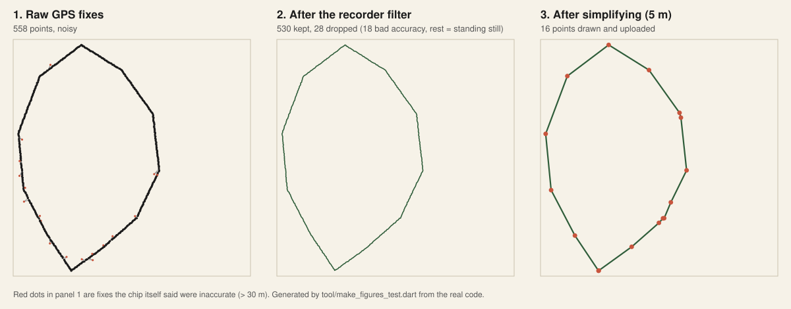
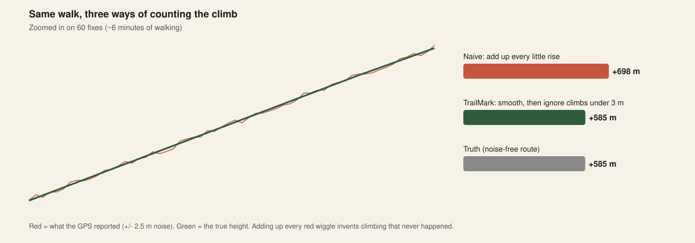

# 5. GPS and track processing

Raw GPS is messy. Turning dots into "4.4 km, +585 m" needs some cleaning. Code: [`lib/core/geo.dart`](../lib/core/geo.dart) and [`lib/tracking/recorder.dart`](../lib/tracking/recorder.dart).

## The pipeline

*This picture is made by running the real code on the demo trail with realistic noise.*

| Stage | What it does | Why |
|---|---|---|
| **Raw fixes** | Every position the chip reports | Includes errors |
| **Filter** | Drop fixes with accuracy worse than 30 m; ignore moves under 4 m | Bad fixes make fake zigzags, standing still makes fake distance |
| **Batch save** | Write 20 points per database transaction | Far less battery and storage wear than 1 write per point |
| **Simplify** | Douglas-Peucker with a 5 m tolerance | Fewer points to draw (built) and to upload (designed), same shape |

### Measured on the demo trail

| | Value |
|---|---|
| Raw fixes | 558 |
| Kept after filter | 530 (18 dropped for bad accuracy) |
| After simplifying | 16 |
| True distance | 4446 m |
| Distance from raw, noisy fixes | 5414 m (**+22%, too long**) |
| Distance after filter | 4573 m (+2.9%) |
| Distance after simplify | 4452 m (+0.1%) |

Honest note: the demo trail is a made-up polygon with straight sections, so 558 to 16 points is *better than a real trail will do*. Real winding paths keep far more points. Measure on real GPX files before promising numbers.

## Counting climb is harder than it looks

GPS height is noisy, often worse than horizontal position. If you add up every little rise you invent climbing: **698 m reported vs 585 m real** on the demo trail, and real chips are noisier than my simulation.

TrailMark uses two defences:
1. **Smooth** heights with a 5-point moving average.
2. **Ignore** rises under 3 m (a threshold with memory, called hysteresis).

> A unit test caught a real flaw here. My first version used only the threshold. When noise was as big as the threshold, a standing-still test reported **72 m** of climb. Adding smoothing fixed it.

Production upgrade: use the phone **barometer** (air pressure) for height. It is much smoother than GPS height.

## Battery: the hidden boss
A 10-hour hike with continuous GPS can drain a phone. Levers:

| Lever | Trade-off |
|---|---|
| Lower sample rate (1 fix per 5-10 s when walking) | Rougher curves |
| OS-level distance filter (we use 3 m) | Slightly delayed fixes |
| Adaptive: sample faster when turning, slower on straight lines | More code |
| Batch writes (done) | A crash can lose the last batch |
| Dim screen, screen-off recording | Needs background mode (below) |

## Background tracking (designed, not built)
Hikers put the phone in a pocket. The OS may then stop the app.
- **Android:** a *foreground service* with a visible notification.
- **iOS:** the *"location updates" background mode* and "Always" permission, with a clear reason string.
- Both stores review this closely, so write an honest purpose text.
- Plugin options: `flutter_background_geolocation` (commercial, very robust) or hand-written platform code.

This prototype records **only while the app is open**. It is the biggest gap between prototype and product.

## Sensors beyond GPS
Barometer (height), compass (heading), heart-rate straps over Bluetooth, and watches (Apple Watch, Wear OS, Garmin). Serious hikers often ask for these.
