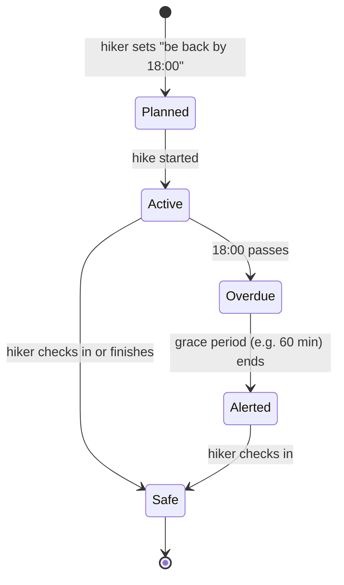

# 7. Safety and privacy

*Status: designed, not built. This is where a hiking app stops being "just an app".*

## Why this is its own chapter
If a photo app fails, someone is annoyed. If a hiking app fails, someone may be in danger. Even if the app only *seems* to promise safety, users may rely on it.

## Safety features

### Live position sharing
- Phone sends "last known position" whenever there is any signal.
- Family sees the position **and its age**: *"2 h 10 min ago"*, never a fake live dot.
- Send small packets (a single coordinate, a few bytes). Even a weak signal can deliver it.

### Check-in timer

Key design point: **the alert must be sent by the server**, not the phone. A dead or lost phone cannot send anything.

### SOS
- Fastest path: "call local emergency number" plus show coordinates in a rescue-friendly format.
- Satellite messengers (Garmin inReach and similar) and phone satellite SOS are *separate systems*. An app should **integrate** and never pretend to replace them.
- Always show: **"This app is not a substitute for emergency equipment."**

### Weather and hazards
Forecast, fire, and avalanche alerts. Cache them for offline, always with a **timestamp** ("as of 06:00"). Old weather shown as current is dangerous.

## Rules for safe design
1. **Never hide staleness.** Show how old every piece of safety data is.
2. **Fail loudly.** If tracking stopped, tell the user clearly.
3. **Fail toward safety.** A false alarm is better than a missed one, within reason.
4. **Never promise rescue.** Write the limits plainly.
5. **Ask a lawyer** about disclaimers and rules in the target countries.

## Privacy
A location history shows where you live, work, and sleep. It is some of the most sensitive data there is.

| Practice | Why |
|---|---|
| Hikes are **private by default** | Sharing must be a choice |
| Hide the start and end area when sharing publicly | Often your home |
| Collect only what you need; keep it only as long as needed | Law and trust |
| Let users export and delete everything | GDPR-style rights |
| Encrypt in transit (HTTPS) and at rest | Basic duty |
| Clear, honest permission texts | Required by app stores |

## Questions for the client
- Does the app claim any *safety* function, or only *recording and planning*?
- Which countries? (law and emergency numbers differ)
- Who is liable if a check-in alert fails?
